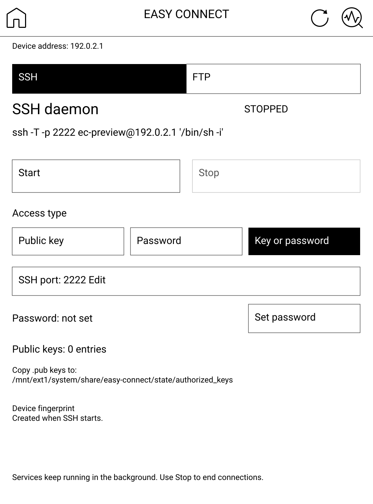
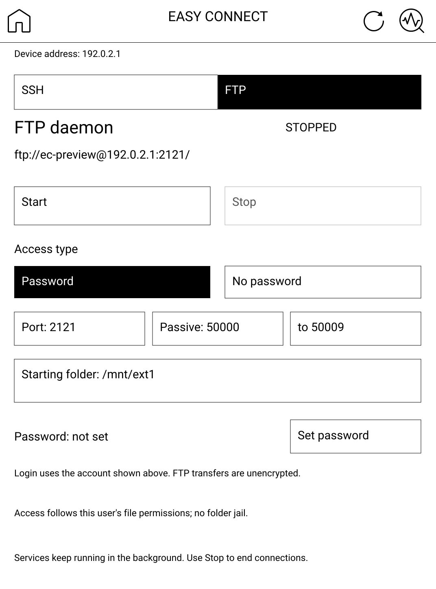

# Easy Connect — SSH and FTP servers for PocketBook

Run an **SSH server and FTP server on your PocketBook e-reader**. Transfer books
and files over Wi-Fi from an FTP client, or use an SSH client for remote shell
access. Easy Connect uses Dropbear and vsftpd, runs without root, and works
independently of CoolReader.

- **Wireless book transfers:** upload, download, rename and organize files with FTP.
- **Remote shell access:** connect over SSH with a password or public key.
- **Background services:** run SSH and FTP independently and keep them running
  after closing the interface; reopen the app to stop either service.
- **Library refresh and Wi-Fi updates:** rescan books after transfers and check
  for verified application updates from the reader.

[Download and installation guide](https://pocketbook.nimbushub.eu/easy-connect.html) · [Latest release](https://github.com/dderugin/pocketbook-easy-connect/releases/latest) · [Report an issue](https://github.com/dderugin/pocketbook-easy-connect/issues)

## Quick start

1. Download the shared install ZIP from the guide. For an upgrade, stop both
   services and close Easy Connect before replacing files over USB.
2. Merge `applications` and `system` into the reader's USB storage root, safely
   eject, connect to Wi-Fi, and open **Applications → EasyConnect**.
3. Choose SSH or FTP, set its password and press **Start**. Use the username and
   address displayed in that tab. Default ports are **2222 for SSH** and **2121 for FTP**.
4. Connect from a client on your computer. After transferring books, refresh the
   Library in Easy Connect. Use **Stop** to end a service when finished.

FTP is unencrypted. **SFTP, SCP and FTPS are not included.** See the guide's
[SSH instructions](https://pocketbook.nimbushub.eu/easy-connect.html#ssh),
[FTP instructions](https://pocketbook.nimbushub.eu/easy-connect.html#ftp) and
[security notes](https://pocketbook.nimbushub.eu/easy-connect.html#security).

## Supported readers

One shared **ARMv7 Linux softfp** package serves Touch HD 3, Verse Pro, Era and
InkPad 4. The same application and service executables are used on every qualified
model. Other models and firmware families require qualification.

The shared package version is **0.3.0**. Known models use API-based firmware
admission, matching the shared CoolReader policy: firmware patch/build numbers
are not an exact-version whitelist. The latest known API level at or below the
installed firmware is selected (6.10/6.11); unknown models and API levels below
6.10 are rejected. Compatible softfp system libraries remain necessary.

| Model | Firmware snapshot used for verification | Portrait size |
| --- | --- | --- |
| Touch HD 3 / PB632 | U632.6.11.2001 | 1072 × 1448 |
| Verse Pro / PB634 | U634.6.10.3425 | 1072 × 1448 |
| Era / PB700 | U700.6.10.3209 | 1264 × 1680 |
| InkPad 4 / PB743G | U743g.6.11.1683 | 1404 × 1872 |

These snapshots define the software checks, not a list of every compatible
firmware build. Physical acceptance of this shared release, scanner behavior,
Wi-Fi, suspend, USB and PTY availability still require testing on each reader.
Earlier PB632 builds have limited physical SSH/FTP evidence, not validation of
this new binary. Android and hard-float PocketBook variants require separate
build families.

## Wi-Fi updates

Version 0.3.0 adds **Check for updates** and **Version** below the service settings
in both tabs. Connect to Wi-Fi, choose Check for updates, and confirm Download
when a newer compatible version is available. The download uses HTTPS with
certificate verification; a SHA-256 check and package/model/API checks run before
anything is installed. The stable channel compares numeric MAJOR.MINOR.PATCH
versions and never offers a downgrade.

Checking and downloading leave SSH, FTP and active connections running. After
verification, choose **Restart now** to explicitly stop both services and install,
or **Later** to keep them running. A staged update installs on a later launch
when both services have stopped. Reopening the interface while services are
running keeps the current runtime in place. Home, Back and ordinary app exit
continue to leave services running. Closing/backgrounding during a transfer
cancels it without replacing the installed app.

The launcher switches a prepared copy into place, preserving configuration,
password verifiers, SSH host keys, custom files and logs. It recovers an
interrupted directory switch and uses the previous controller to roll back if
the updated interface fails its first run. It does not restart services after an
update. Save diagnostics and check `ui.log` if installation fails.

**Install 0.3.0 over USB once** to obtain the updater and stable launcher; 0.2.x
cannot update itself. Later releases use the shared Wi-Fi channel. The stable
launcher remains in place during Wi-Fi updates; a release that needs a different
bootstrap must explicitly require USB installation. The seven-file install ZIP
stores its version/family/API registry in the ZIP comment, keeping metadata out
of the reader's Library. Wi-Fi updates use the same release ZIP as USB installs.

## Screenshots and controls

UI previews rendered from the 0.2.0 application code with the native PocketBook
toolbar and font. These show a Touch HD 3-sized layout; they are not
physical-device captures. Layout and firmware styling can vary by reader.
The address `192.0.2.1` and account `ec-preview` are examples; use the values
shown on your device.

| SSH tab | FTP tab |
| --- | --- |
| [](docs/screenshots/0.2.0/ssh.png) | [](docs/screenshots/0.2.0/ftp.png) |

The toolbar has **Home** on the left, then **Refresh Library** and **Save
diagnostics** on the right. Home closes the interface and starts a Library
refresh; running SSH and FTP services continue. Reopen Easy Connect and press
**Stop** in the corresponding tab to end a service. The previews show both
services stopped; SSH “Key or password” is an example selection.

Select either image to view it at full size. See the
[web manual](https://pocketbook.nimbushub.eu/easy-connect.html#screenshots)
for installation and connection steps.

## Implemented

- Portable C controller and diagnostics command.
- Dropbear SSH: public key, app-specific password, or either method.
- Persistent per-device Ed25519 host keys and host-key fingerprint output.
- Configuration validation, private runtime staging, exclusive session lock,
  server supervision, startup checks, and a background controller independent of the UI.
- Two InkView tabs, SSH and FTP, each with daemon status, independent Start/Stop
  buttons, connection details and saved configuration.
- Native firmware Home, refresh and diagnostics icons with the system application-caption font.
- On-device password setup with masked entry and confirmation, plus SSH public
  key count/location and server fingerprint.
- vsftpd FTP as the **launching user**, with either a separate application
  password or explicit anonymous access. Optional privileged launches can use chroot.
- Separate device build/package scripts, checksummed source dependencies, and
  automated controller/real SSH integration tests.

Normal operation uses the launching account, with no fixed UID or username and
no root requirement. Host integration tests exercise actual SSH/FTP sessions;
firmware probes run the ARM service tools and core operations under each pinned
runtime. They cannot establish the physical reader's kernel or account policy.

## Build and test on a computer

Requirements: CMake 3.18+, C compiler, Make, Python 3, OpenSSL development files,
libcurl and zlib development files, and OpenSSH client/keygen for integration tests. No Python is needed on the reader.

```sh
cmake -S . -B build
cmake --build build
ctest --test-dir build --output-on-failure

# Explicit network step; subsequent builds use the verified offline cache.
python3 tools/dependencies.py fetch
python3 tools/dependencies.py build --service dropbear
python3 tests/test_ssh.py build/easy-connect
python3 tools/dependencies.py build --service vsftpd
python3 tests/test_ftp.py build/easy-connect
python3 tests/test_background.py build/easy-connect
python3 tests/test_sessions.py build/ec-ui-test

# Render both tabs from the actual C drawing code. Native assets remain local.
python3 tools/native_theme.py work/firmware/pb632-native-theme.pbt --output work/native-ui-reference/pb632
python3 tools/preview-ui.py --build build --theme-reference work/native-ui-reference/pb632 --out work/ui-preview
```

For Homebrew OpenSSL on macOS, append
`--openssl-prefix /opt/homebrew/opt/openssl@3` to the dependency build command
(use the actual installed prefix). Linux builds need OpenSSL development headers.
If CMake cannot find OpenSSL, configure with `-DOPENSSL_ROOT_DIR=/path/to/openssl`.
Linux and macOS support controller, SSH and FTP development tests. The macOS
vsftpd build disables unavailable wtmp logging and Linux-style address-space caps;
these compatibility changes do not apply to the Linux/ARM build.
Tests listen only on loopback and use disposable keys and credentials.
CTest includes controller, core filesystem/credential, UI, and offline packaging
and dependency tests. The integration commands above exercise real daemons and
independent service lifecycles. See [the test coverage matrix](tests/README.md)
for covered behavior and the remaining SDK/device validation gaps.

## Build the shared reader package

The platform, version, CPU flags and model registry live in
`config/pocketbook.json`; pinned firmware archives are in `config/firmware.json`.
CMake and the daemon builds use the same ARMv7-A/NEON/VFPv3 softfp flags. The
SDK's static crypto retains its own recorded ARM attributes; the supported
models are checked with Cortex-A7 emulation. CPU/library ABI compatibility for
additional models needs qualification before enabling them.

On macOS or Linux with Docker and its Buildx component:

```sh
bash tools/build-shared-docker.sh
```

The wrapper mounts source read-only and stores build caches in the
`easy-connect-pocketbook-armv7-softfp-work` volume. It runs tests as a non-root
account on the Docker engine’s native architecture, so rootless SSH/FTP cases
are executed without translating the host daemons. On ARM64 Docker engines,
x86_64 binary translation must be enabled for the SDK compiler tools. The image
provides their x86 libraries while keeping host tests and QEMU native.
First setup downloads and
verifies the pinned SDK, daemon sources and four firmware archives. No runtime
firmware files or SDK archive are included in either release ZIP.

To reuse existing local CoolReader input caches without making Easy Connect
depend on that application:

```sh
EC_SDK_VOLUME=coolreader-pocketbook-armv7-softfp-work \
EC_ARCHIVE_CACHE=/path/to/pocketbook-coolreader/work/downloads \
EC_RUNTIME_CACHE=/path/to/pocketbook-coolreader/work/qualification \
bash tools/build-shared-docker.sh
```

`POCKETBOOK_SDK` can select the pinned SDK on a native Linux x86_64 build host.
The same pipeline can run with `bash tools/build-docker.sh` after installing
build-essential, cmake, Python, OpenSSL development headers, OpenSSH client,
libarchive-tools, curl, git, QEMU ARM 9.2+, e2fsprogs and squashfs-tools. The Docker wrapper
includes a pinned modern emulator. Native Linux builders can use
`bash tools/fetch-qemu.sh /tmp/ec-qemu-arm` and set `EC_QEMU=/tmp/ec-qemu-arm`;
this copies a build tool without registering or changing system emulation. The historical
`toolchain-touch-hd3.cmake` filename forwards to the shared toolchain.

Before packaging, the pipeline runs native controller/UI/SSH/FTP/session tests,
then checks all five ARM executables against all four firmware dependency
closures and verifies the native theme has the caption style and all three toolbar icons. QEMU probes exercise password/filesystem operations, real SSH key and
password login, authentication rejection, passive FTP transfers and anonymous
FTP. The UI loader is checked separately; physical rendering and device events
remain unverified. Static crypto symbols are hidden from firmware libraries, and
the launcher applies the firmware executable-stack compatibility setting.

Outputs:

- `dist/easy-connect-pocketbook-armv7-softfp-0.3.0.zip`
- `dist/easy-connect-pocketbook-armv7-softfp-0.3.0-sources.zip`
- Their `.sha256` files.

The install ZIP still contains only seven runtime files: the launcher, five
executables and factory configuration. Source, notices, build metadata and the
firmware verification report remain in the separate companion archive for the
computer. Missing or stale firmware/binary/source evidence blocks packaging.

## Install and configure

For an upgrade, press **Stop** in both the SSH and FTP tabs, then tap the
**Home** icon before connecting USB and replacing files. Closing the UI alone
leaves its background controller and any running services active. If files were
replaced while services were running, safely eject USB and fully power the
reader off and on before testing the installed build.

1. Extract/merge the ZIP into the reader's USB storage root.
2. Factory configuration is included as `system/share/easy-connect/easy-connect.conf.default`.
   The app reads it when no saved `easy-connect.conf` exists. Saved settings always
   take precedence; changing a setting in the UI writes `easy-connect.conf`.
3. SSH and FTP initially use separate application passwords. Press **Start** in
   each tab to set its password, then press **Start** again to run the service.
   For SSH key access, select **Public key** and import your `.pub` key over USB.
4. Safely eject USB, connect the reader to Wi-Fi using its settings, then open
   **Applications → EasyConnect**.
5. Start the desired service. Closing or backgrounding the app leaves services running; reopen it and press **Stop** to end them.

The ZIP includes factory configuration only, with no shared password or anonymous
access enabled. It never includes saved `easy-connect.conf`, credentials or host
keys, so upgrades preserve them. The app creates state and daemon configuration
files as needed; missing credentials prompt for setup instead of being shipped as
empty placeholder files. It does not modify CoolReader files or firmware system accounts.
Services do not automatically start at boot. They can run with the interface closed;
Wi-Fi keepalive and suspend/USB behavior still need physical-device validation.

### Device interface

The **SSH** tab shows daemon status, its connection command, Start/Stop buttons,
Public key / Password / Key or password selection, editable port, password
configuration status and setup button, and public-key installation details.
The server fingerprint is displayed after the host key has been created.

The **FTP** tab shows daemon status, its connection URL, Start/Stop buttons,
Password / No password selection, editable control/passive ports and starting
folder, and the relevant username/password or anonymous-login details.

The interface checks the device IP address every second. While no address is
available, service buttons and settings are disabled and a Wi-Fi connection
hint is shown. Controls enable automatically when an address appears; no manual
refresh is required. Tabs, Stop and all three top-bar icons remain available offline.
The **Home** icon on the left closes Easy Connect. The circular-arrow icon
refreshes the Library, and the native diagnostics icon saves a diagnostics report.

Changes save immediately and survive app restarts. Configuration for a running
daemon is locked; stop that daemon before editing it. Stopping SSH leaves FTP
running, and stopping FTP leaves SSH running. Keyboard overlays do not stop the
other daemon. Home, Back, closing and backgrounding leave both services and active transfers
running. Reopen Easy Connect to see their status and press **Stop** in either
tab to stop that service. The other service continues. The controller exits and
removes its staged credentials when both services are stopped. A reboot stops
all services; they are not automatically started again.

Each password is entered twice with masked input and saved as a salted verifier.
Existing passwords are never displayed. Public key import is currently via USB;
the UI reports the file location and entry count.

### Refresh the PocketBook Library

After copying, renaming or removing books over FTP/SSH, tap the **circular-arrow icon** in the top bar of
either tab. SSH/FTP can remain running, including active transfers. The action
also works without Wi-Fi. It asks the firmware's `/ebrmain/bin/scanner.app` to rescan;
the firmware may display a scanning screen. Open Library after it finishes.

While a refresh runs, its icon is dimmed and the status message shows progress. Services can still be
started or stopped. Existing connections remain active while the firmware scanner
temporarily takes the screen, including until Easy Connect returns to the foreground.
Files still being uploaded may need another refresh after the upload completes.
A background supervisor watches for the scanner's completion message,
then dismisses only the scanner instance it started. It never kills the system's
persistent scanner. A two-minute timeout prevents a stuck temporary scanner from remaining open. The app reports failures and keeps
`system/share/easy-connect/library-scan.log` for diagnostics. Missing firmware
scanner support is reported on screen. Refreshing does not reset the Library
database or erase reading history.

Every normal app exit, including the Home icon, Back and a firmware close event,
also refreshes the Library automatically. Easy Connect hands off a fresh scan
and closes without waiting for it or interrupting either service. An in-progress
manual scan is replaced by this final scan. Files uploaded after this scan need
a later refresh; reopen the app and tap Refresh, or close it again. The final scanner has the same two-minute
limit and only manages its own scanner instance; its result is recorded in
`system/share/easy-connect/library-exit-scan.log`. An unavailable scanner or a
startup failure is recorded in `ui.log` without preventing exit. Force-killing
the process cannot run an exit action.

This firmware integration still needs
physical acceptance testing on each model.

### Background services

The UI reconnects to its controller through a private socket under
`/tmp/easy-connect-UID/`. The controller runs as the launching account and owns
its SSH/FTP supervisors; closing or even force-killing the UI leaves it running.
Only the same account can control it, and Stop targets its owned processes
rather than trusting saved PID files. Existing settings are shown and locked
for running services after reopening the UI. No additional executable is
installed: the existing `easy-connect` tool also runs the headless controller.

For command-line control of UI-started services:

```sh
system/share/easy-connect/bin/easy-connect background-status
system/share/easy-connect/bin/easy-connect background-stop ssh
system/share/easy-connect/bin/easy-connect background-stop ftp
```

`background-start ssh|ftp` also starts the shared controller on demand.
The developer command `serve ssh|ftp|both` continues to run in the foreground
and stops its own services on Ctrl-C/SIGTERM.

### SSH public keys

Generate a client key on the computer:

```sh
ssh-keygen -t ed25519 -f ~/.ssh/pocketbook
```

Copy the **public** `pocketbook.pub` contents to
`system/share/easy-connect/state/authorized_keys` over USB. Multiple keys may be
listed one per line. Keep the private client key on the computer. Use `auth=key`.
The screen reports the actual device account name and address:

```sh
ssh -T -p 2222 -i ~/.ssh/pocketbook DEVICE_USER@DEVICE_IP '/bin/sh -i'
```

Compare the server fingerprint with the device screen before accepting it.
SSH sessions have the launching account's permissions; ordinary launches do not
provide root access. Firmware may deny PTY allocation to the normal reader account.
The connection hint uses `ssh -T` to skip PTY allocation and `/bin/sh -i` to show
a shell prompt over ordinary pipes. The shell may print "can't access tty; job
control turned off"; basic commands still work. Terminal applications and job
control require PTY access. Physical-reader verification remains pending. SFTP and SCP support are not included yet.

### SSH password

Use **SSH → Password / Key or password → Set password**, or run the host tool
while the reader is mounted over USB:

```sh
python3 tools/set-password.py /path/to/reader/system/share/easy-connect/state
```

The tool prompts twice and writes a salted PBKDF2-HMAC-SHA256 verifier, not the
plaintext password. Set `auth=password` for password-only access or `auth=both`
for password **or** public-key access. `both` requires a nonempty `authorized_keys`
file too. Keys/passwords are copied at service startup: stop and restart services
after changing, resetting or revoking credentials. Missing/corrupt password files
never fall back to firmware account authentication.

### FTP as the current user

```sh
python3 tools/set-password.py /path/to/reader/system/share/easy-connect/state --service ftp
```

Leave `ftp_user=current` (also the default). It resolves to the account launching
Easy Connect, with no account switching or privileged operations. Existing
configurations with `ftp_user=reader` work if that is the launching account;
otherwise change them to `current`. The account must have a non-root UID.
The default `ftp_auth=password` uses the account shown on the device screen and
the separate FTP password. Set it in **FTP → Password → Set password** or with
the host tool above. The default control port is **2121**; passive data ports are
**50000–50009**. Active-mode FTP is disabled.
Plain FTP sends passwords and file contents unencrypted; use it on a trusted LAN.
macOS Finder mounts FTP connections read-only. Use an FTP client with upload
support to create, upload, rename or delete files.

**FTP → No password** saves `ftp_auth=anonymous`. Clients log in as `anonymous`
(or `ftp`) without an application password. No password file is required. This
mode explicitly permits listing, downloads, uploads, rename, deletion and directory
creation under the same OS account permissions. Anyone who can reach the FTP port
can use these operations; choose this mode only when that access is intended.
Switching back to Password retains the existing password verifier.

In normal-user mode, `ftp_root`, initially `/mnt/ext1`, is the **starting
directory, not a jail**. FTP clients can leave it and access any file readable or
writable by that account, just as they can through SSH. Files remain subject to
the OS account's permissions. Upload, download, rename, delete and directory
creation are supported. Use this mode for a trusted owner of the reader.

The rootless adapter enables authenticated local login in vsftpd's existing
single-process mode. It validates the launching UID and the separate Easy Connect
password, without PAM, system passwords, setuid or chroot. Named login is disabled
in anonymous mode, and anonymous login is disabled in password mode.
The upstream post-login seccomp policy cannot support this pre-login
password verification, so rootless sessions do not use that filter. Upstream
vsftpd 3.0.5 has no ARM seccomp filter in any case.

If Easy Connect is explicitly launched as root, set `ftp_user` to an existing
non-root account. That optional mode retains vsftpd's two-process model and
chroot confinement, including writable chroot support for reader storage; it is
not covered by the rootless transfer tests.

## Command-line usage

```sh
easy-connect --root /absolute/application/folder doctor
easy-connect --root /absolute/application/folder serve ssh
easy-connect --root /absolute/application/folder serve ftp
easy-connect --root /absolute/application/folder serve both
easy-connect --root /absolute/application/folder fingerprint
```

`serve` stays in the foreground; Ctrl-C stops it. Starting `both` is transactional:
if either service fails, both stop. Only one controller instance per UID may run.
`doctor` reports UID/GID, account/shell, network addresses, PTY availability,
storage information, daemon presence, FTP account and confinement mode. The device screen
can export `diagnostics.txt`; the launcher records startup output in `ui.log`.
Service logs live in the reported private `/tmp/easy-connect-UID/session.*/`
directory. They survive service shutdown for diagnosis and disappear on reboot.
Logs currently have no size cap; prolonged debug use needs free-space monitoring.

On Linux, each daemon has its own supervisor and child-subreaper to adopt and
terminate its session descendants independently on normal shutdown. Supervisors
and listeners receive parent-death signals. Abrupt process/kernel failure is not
a guarantee of session cleanup.
On macOS only process-group cleanup is available; detached interactive session
cleanup is a Linux/device acceptance test.

## Credential storage

Runtime copies require an owned Unix directory with mode 0700 and files with
mode 0600. A small Dropbear patch stops ancestor permission checks at the explicitly
selected, validated private key directory; file/owner/mode checks remain enabled.
This lets the runtime live under `/tmp` without broadly disabling key checks.

Persistent `state/` may be on FAT storage, where Unix permissions do not provide
protection. Anyone with USB access or the same device account may read/change
the stored server key and password verifier. Keep the FTP shared root away from
credentials if access should be narrower than full reader administration.
`state_dir` may point to an existing suitable persistent directory discovered
during device diagnostics. This version does not encrypt secrets at rest.

## TODO

### Remaining device acceptance

The shared build records software evidence for the four pinned runtimes. Each
reader still needs physical checks for touch and keyboard input, rotation,
firmware scanner integration, launch account/permissions, SSH shell and PTY,
password/key persistence, FTP ownership, independent service Stop, suspend,
Wi-Fi reconnection, cover events and USB transitions. Record model, exact
firmware and diagnostics; do not infer hardware support from an emulator result.

### Follow-up features

- [ ] Add on-device SSH public-key import.
- [ ] Add network lifecycle controls based on the device validation results.
- [ ] Bound service log size and retention.

## Sources and license

New project code: GPL-2.0-or-later; see `LICENSE`. Dropbear retains its upstream
license notices; vsftpd is GPL v2. Build adapters are in `tools/dependencies.py`
and `adapters/password.h`; source archive versions/hashes are in `dependencies.json`.
The application-specific password adapter keeps each daemon's protocol handling
and the controller restricts SSH to the launching UID.

- [Dropbear upstream](https://github.com/mkj/dropbear)
- [vsftpd upstream](https://security.appspot.com/vsftpd.html)
- [vsftpd rootless restrictions](https://security.appspot.com/vsftpd/vsftpd_conf.html)
